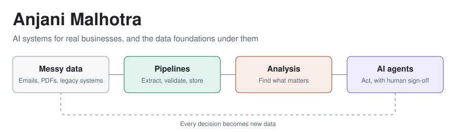

<picture>
  <source media="(prefers-color-scheme: dark)" srcset="assets/header-dark.svg">
  
</picture>

I work the way a forward deployed engineer does: find the real problem inside a business, then build the smallest AI system that fixes it, without replacing what already works.

## Latest work

### [PayNest Contract Copilot](https://github.com/AnjaniMalhotra/legal-docs-review)

A fully local AI copilot that reviews contracts against company standards. It gives a plain-English summary, chat with page citations, a 0–100 risk score, and a lawyer's sign-off. Nothing leaves the machine.

**Stack:** Ollama, LangGraph, Chroma, FastAPI, Bifrost, Langfuse, Ragas  
[View the presentation](https://anjanimalhotra.github.io/legal-docs-review/) · *Fictional company, built as a teaching project*

### More recent projects

| Project | What it does | Built with |
|---|---|---|
| [**Insurance settlements, without the retyping**](https://github.com/AnjaniMalhotra/Hospital-insurance-FDE) | Adds one reconciliation tab to a hospital's existing billing system, where AI reads settlement emails from six insurers, each in its own format. *Fictional hospital, training project.* | Python, Gemini |
| [**Business Lead Inbox**](https://github.com/AnjaniMalhotra/JEV-Business-Leads-Inbox) | Routes business email, grades sales leads A–D, puts hot leads first, and drafts replies with an LLM. | Python, Streamlit |
| [**News Digest Bot**](https://github.com/AnjaniMalhotra/news-digest-bot) | Summarizes the day's headlines and sends them to Telegram, built up in three stages: deploy, automate, observe. | Gemini, Docker, Cloud Run, Pub/Sub |
| [**Northstar Freight legacy system**](https://github.com/AnjaniMalhotra/FDE-northstar-legacy-system) | The client's "before" system for an FDE capstone: a freight portal that an AI copilot is added to later. *Fictional company.* | Postgres, Cloud Run, Terraform |

## Recently shipped

<!-- RECENT:START -->
- **5 Nov 2026** · [legal-docs-review](https://github.com/AnjaniMalhotra/legal-docs-review)
- **30 Oct 2026** · [Hospital-insurance-FDE](https://github.com/AnjaniMalhotra/Hospital-insurance-FDE)
- **23 Oct 2026** · [FDE-northstar-legacy-system](https://github.com/AnjaniMalhotra/FDE-northstar-legacy-system)
- **7 Oct 2026** · [JEV-Business-Leads-Inbox](https://github.com/AnjaniMalhotra/JEV-Business-Leads-Inbox)
- **19 Sep 2026** · [news-digest-bot](https://github.com/AnjaniMalhotra/news-digest-bot)
<!-- RECENT:END -->

## What I work with

- **AI:** LangGraph, RAG with Chroma, Ollama, Gemini, evaluation with Ragas, tracing with Langfuse
- **Data and cloud:** Python, SQL, Postgres, FastAPI, Docker, Google Cloud, Terraform
- **Analysis:** Jupyter, Streamlit, explainable ML

## Earlier work

[ML Who?](https://github.com/AnjaniMalhotra/ML-Who-) · [Delhi AQI analysis](https://github.com/AnjaniMalhotra/Delhi_AQI_Analysis) · [Maximising taxi revenue](https://github.com/AnjaniMalhotra/Maximising-Taxi-Revenue-Project)

## Get in touch

[LinkedIn](https://www.linkedin.com/in/anjani-malhotra) · [Portfolio](https://anjanimalhotra.github.io/)
